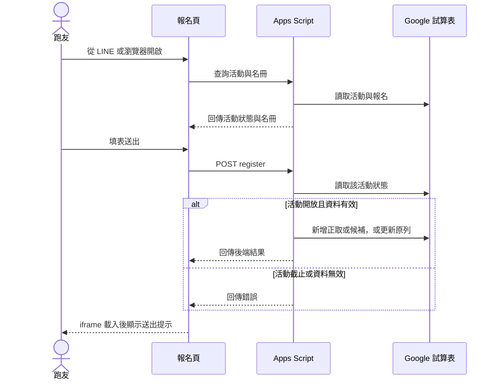
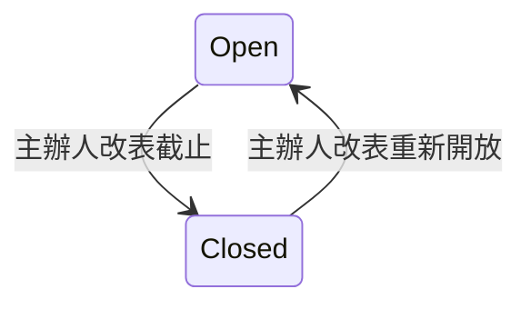

# 報名流程與活動狀態

## 跑友報名

GAS 在收到請求時檢查活動。若主辦人在跑友填表期間關閉報名，GAS 仍會拒絕新增和修改。現行 iframe 提示可能仍顯示成功。

## 主辦人開關報名

1. 在 Activities 確認活動 ID 和資料列。
2. 設定 status 為 Open 或 Closed。
3. 重開報名頁對照場次和狀態。若另有 Open 場次，預設頁可能改顯示另一場。
4. 若需群組公告，由主辦人確認內容和公開範圍，再手動發送。
