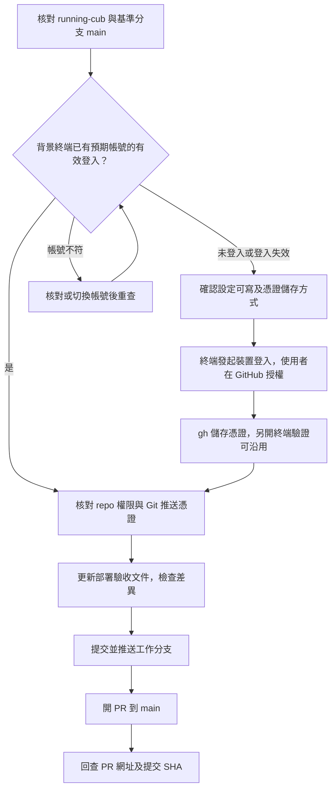
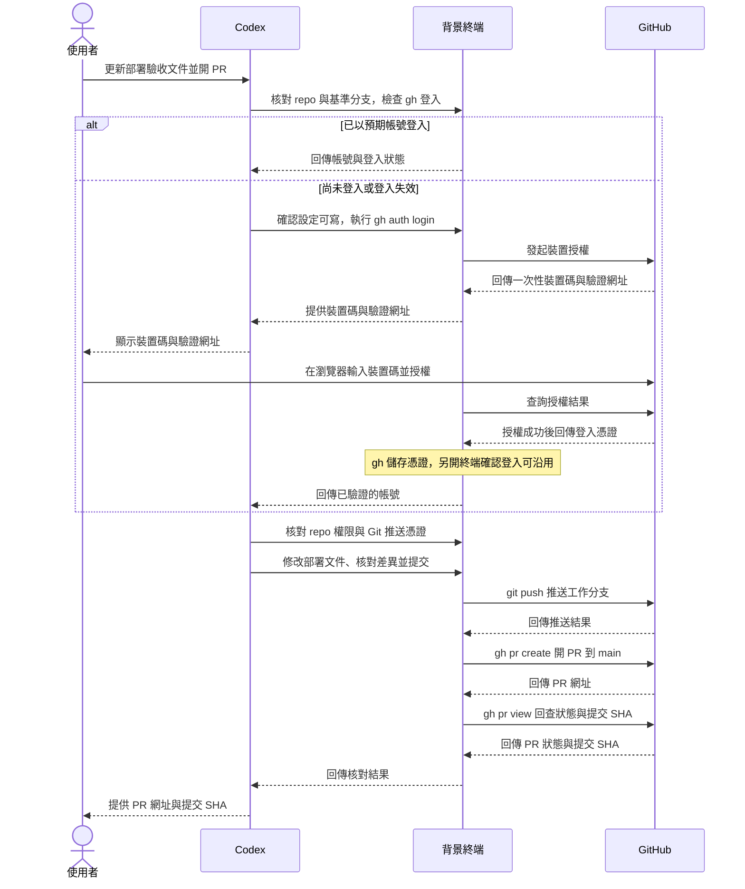

# 用 GitHub CLI 登入與開 PR

以跑團報名專案的「更新部署驗收文件並開 PR」為例，說明共用登入流程如何接上專案更新。範例 repo 為 `TaylorShiehUSI/running-cub`，PR 的基準分支為 `main`。

| 責任 | 範例中的做法 |
|---|---|
| 共用登入流程 | 在實際執行指令的背景終端檢查 `gh auth status`。已有有效登入時沿用，需要登入時由終端發起裝置授權。 |
| 專案更新流程 | 核對遠端 repo、基準分支及權限。更新文件後，推送工作分支並開 PR。 |
| GitHub 權限 | GitHub 按照帳號、憑證、repo 權限與分支規則判斷操作是否可執行。 |

## 流程圖

## 時序圖

瀏覽器顯示授權成功後，背景終端還要成功保存憑證，才能讓下一個命令沿用。以 HTTPS 推送時，Git 也需要能取得憑證。開 PR 後，可用 PR 網址、基準分支及提交 SHA 核對結果。

[跑團部署與驗收文件](deployment-and-tests.md)
