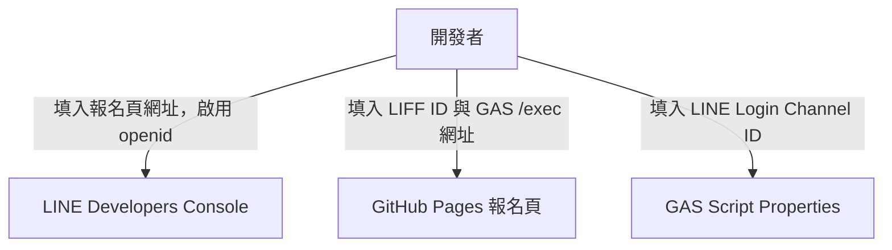
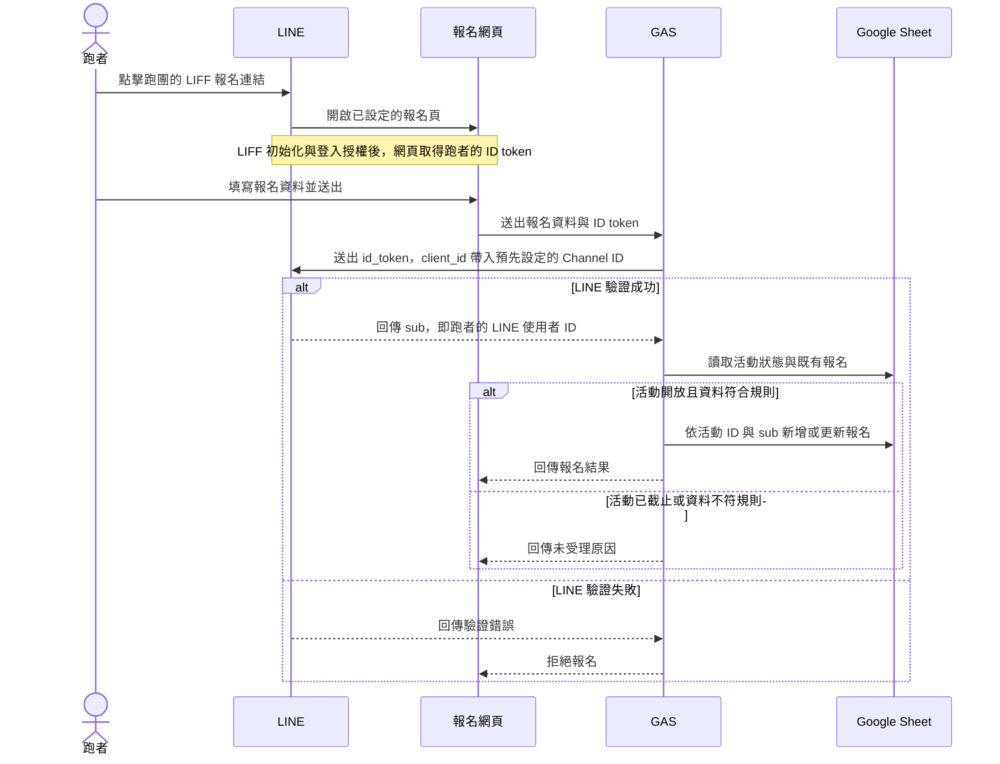

# 跑團報名系統｜設定與報名資訊流

本文件記錄 LIFF、GitHub Pages、Google Apps Script（GAS）與 Google Sheets 如何接在一起。報名、寫入與截止已有驗收紀錄。下圖的 GAS 向 LINE 驗證 ID token 屬於待實作設計。

## 一、設定｜開發者先接好管道

| 設定動作 | 在哪裡填 | 填入什麼 |
|---|---|---|
| 告訴 LINE 要開哪個網頁 | LINE Developers Console 的 LIFF 設定 | 在 **Endpoint URL** 填入 GitHub Pages 報名頁網址。要取得 ID token，另啟用 `openid` scope。 |
| 告訴網頁要把報名送給哪個 GAS | GitHub Pages 報名頁的前端程式 | 填入 GAS Web App 部署後的 **`/exec` 網址**。網頁也填入 **LIFF ID**，供 `liff.init()` 初始化。 |
| 告訴 GAS 要驗證哪個 LINE Login Channel | GAS 的 Script Properties | 在待實作的 `LINE_LOGIN_CHANNEL_ID` 設定填入該 LIFF App 所屬的 **LINE Login Channel ID**。 |

## 二、報名｜接上後端身分驗證後的資訊流

**Channel ID** 是 GAS 事先設定的固定值，用來指定憑證應屬於哪個 Channel。**ID token** 是跑者隨表單送來的憑證。**`sub`** 是 LINE 驗證成功後回傳的帳號識別。LINE 確認身分後，GAS 再依活動是否開放及報名規則決定是否受理。報名驗證透過 LINE Login API 完成。Bot Webhook 屬於接收 LINE 事件的另一條資訊流。

參考 [LIFF API](https://developers.line.biz/en/reference/liff/#get-id-token) 與 [LINE Login ID token 驗證 API](https://developers.line.biz/en/reference/line-login/#verify-id-token)。
