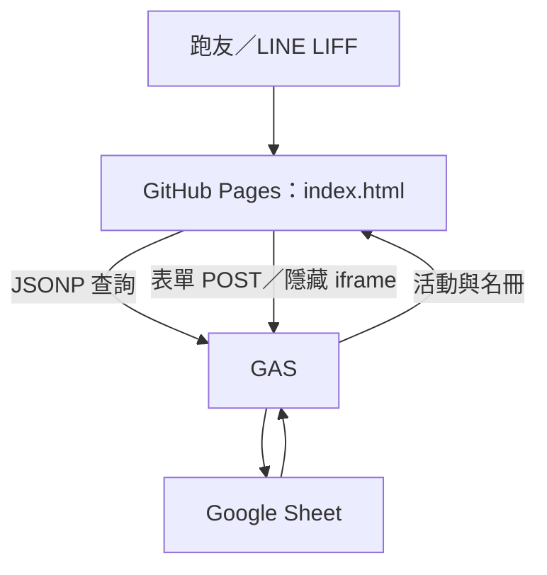
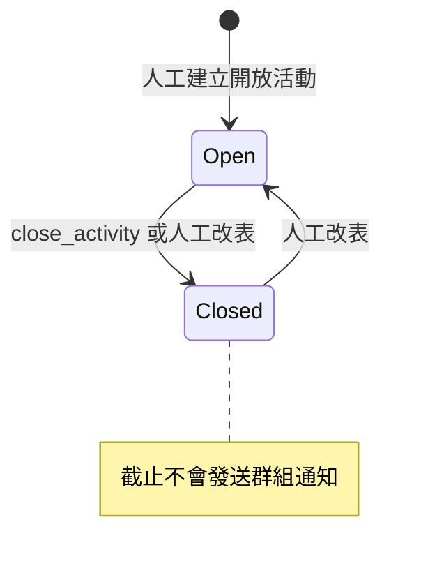
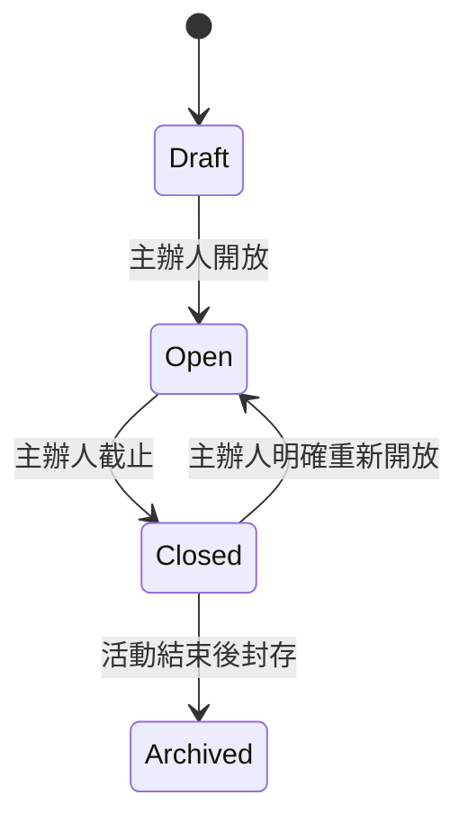
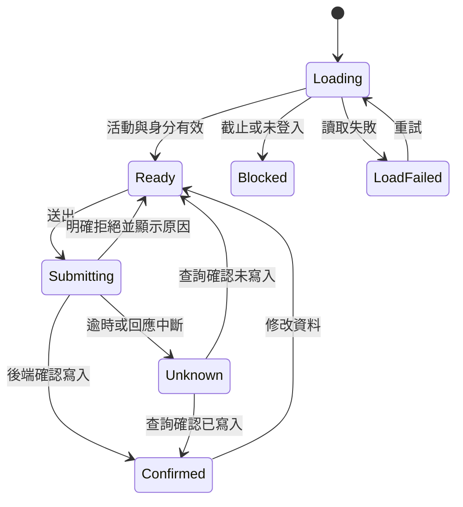
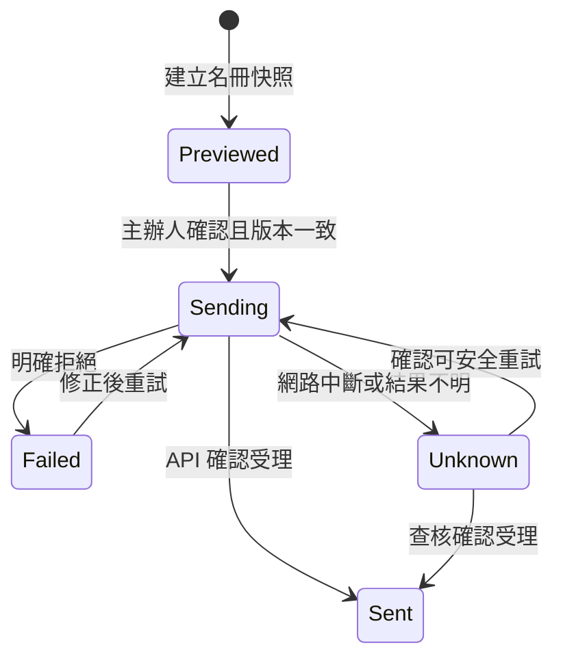
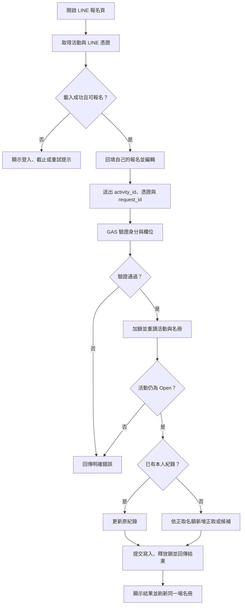
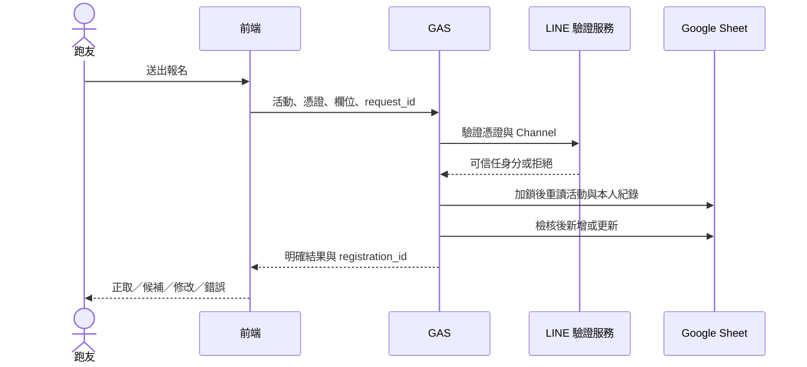
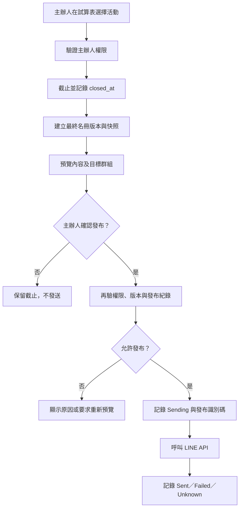

# LINE 團練報名系統：功能與程式審核文件

- 版本：v1.0 審核草案
- 日期：2026-10-29（台灣時間）
- 狀態：待需求與技術方案審核，尚未實作
- 範圍：現況功能、狀態與流程、Code Review、修改建議、主辦人操作與群組通知
- 本次僅新增文件；不修改 index.html、GAS、試算表、部署或觸發條件。

## 1. 目標與範圍

跑友從 LINE 開啟表單，報名資料寫入 Google Sheet；主辦人確認截止後，預覽最終名冊並確認發布至指定 LINE 群組。

第一階段保留 GitHub Pages＋LINE LIFF＋GAS＋Google Sheet 架構。主辦人優先透過試算表自訂選單操作，不另建管理網站。

本文件區分「已確認現況」與「建議目標」。建議尚未視為核准需求。取消報名、自動遞補、多活動選擇與自動截止列為後續範圍。

## 2. 審核依據與限制

| 來源 | 審核方式與版本 |
| --- | --- |
| [index.html](../index.html) | 完整靜態閱讀；main 的 blob SHA：`f559bd5a1197f18f67df3bda45d27e511811b9da`；建立文件前確認未變 |
| 綁定試算表 | 2026-10-29 唯讀檢視 Activities、Registrations、Notifications 的 A1:O35 |
| 綁定 Apps Script | 從試算表「擴充功能 → Apps Script」開啟，完整閱讀唯一的「程式碼.gs」 |
| 觸發條件 | 目前登入帳戶頁面顯示 0 個觸發條件；不代表其他帳戶不可能建立觸發條件 |

GAS 原始碼未納入儲存庫，無可引用的 Git commit；以下以函式名稱定位。尚未核對編輯器內容與線上 /exec 部署版本是否一致。未實際提交報名、截止、執行函式或發送 LINE 訊息。以下是靜態審核，不是端到端測試通過報告。

公開文件不收錄跑友姓名、LINE User ID、私人試算表與 Script 專案網址、Token 或群組識別碼。

## 3. 現況架構

目前只有查詢與報名主流程。LINE 群組發送邏輯尚未實作。

### 3.1 已確認功能

| 功能 | 現況 |
| --- | --- |
| LINE 個人資料 | LIFF 取得姓名、頭像與 User ID；失敗後改用隨機 USER_ 身分 |
| 活動選取 | doGet 從最後一列往上找 Open；沒有 Open 時顯示最後一列，不按活動日期排序 |
| 指定活動查詢 | GAS 支援 activity_id；現有前端查詢未帶入此參數 |
| 報名新增／修改 | doPost → handleRegistration；活動 ID＋非空 User ID 相同時更新 |
| 後端截止檢核 | 非 Open 拒絕新增及修改 |
| 額滿候補 | 該活動所有紀錄筆數達上限後，新增者標記候補 |
| 同時寫入 | doPost 使用 ScriptLock，等待上限 10 秒 |
| 手動截止 API | close_activity 寫入 Closed 與 closed_at |
| 通知 | 僅有 Token 預留常數與 Notifications 表頭；沒有發送及記錄邏輯 |
| 自動換期 | 挑選最後一筆 Open；不會自動建立新活動或依日期截止 |

## 4. 功能需求與驗收

下表為建議目標。P0 為報名可信度與權限，P1 為主辦人發布流程，P2 為後續擴充。

| ID | 優先 | 功能需求 | 驗收條件 |
| --- | --- | --- | --- |
| FR-01 | P0 | 載入完成前禁止報名；失敗可重試 | 無有效活動、載入中及讀取失敗時無法送出 |
| FR-02 | P0 | 明確綁定使用者看到的活動 | 缺少或不存在的 activity_id 回傳錯誤，不暗中改報其他活動 |
| FR-03 | P0 | GAS 驗證 LINE 憑證 | 無效、過期或錯誤 Channel 的憑證被拒絕；User ID 由驗證結果取得 |
| FR-04 | P0 | 同一人同場次僅一筆 | 重送與修改保留 registration_id、created_at；更新 updated_at |
| FR-05 | P0 | 讀取自己的報名 | 僅可讀自己的詳細紀錄；重新開啟可回填 |
| FR-06 | P0 | 以後端結果顯示報名狀態 | 正取、候補順位、修改成功、截止、失敗分別顯示 |
| FR-07 | P0 | 截止與名額在後端執行 | 同搶最後一席不超收；截止後新增、修改均拒絕 |
| FR-08 | P0 | 所有寫入入口做權限及欄位檢核 | 一般跑友無法截止；空值、過長文字及不合法動作被拒絕 |
| FR-09 | P1 | 主辦人手動截止 | 截止成功後記錄真實時間；重複截止不覆寫原截止時間 |
| FR-10 | P1 | 發布前預覽 | 可核對活動、正取、候補、目標群組與名冊版本 |
| FR-11 | P1 | 確認後發群組通知 | 只有有權主辦人可發送；未設定群組或 Token 時禁止發送並說明 |
| FR-12 | P1 | 發布紀錄及可控重試 | 成功、失敗、結果不明可區分；已成功版本不被重複發送 |
| FR-13 | P2 | 取消與候補遞補 | 規則另行核准；未核准前不承諾此功能 |
| FR-14 | P2 | 多場次、定時截止與統計 | 另案定義權限、排程及活動選擇規則 |

## 5. 狀態圖

### 5.1 現況活動狀態

目前後端只接受精確的 Open；Closed、拼字錯誤或其他值全部拒絕報名。現況沒有草稿、已發布或自動截止狀態。

### 5.2 建議活動狀態

活動狀態與通知狀態分開。發布失敗不重新開放報名；重新開放後若名冊變更，必須產生新版本並重新預覽。Draft、Archived 為新增建議，需前後端一併支援。

### 5.3 建議前端狀態

Unknown 時不得直接顯示失敗或自動新增；應先查自己的報名與 request_id。

### 5.4 建議通知狀態

Sent 表示 LINE API 已受理，不代表每位群組成員已閱讀。僅靠本地日誌無法保證跨服務「絕不重送」；實作前須核對 LINE 官方提供的重試去重機制及限制。

## 6. 流程圖與時序

### 6.1 建議報名流程

憑證無效或活動截止時，在寫入前終止。傳輸逾時時另走報名查核流程。

### 6.2 建議主辦人截止與發布

不以儲存格 onEdit 自動發訊息；截止與發送分開，避免誤觸。主辦人須在發送前看見確切內容與群組。

## 7. Code Review 結果

嚴重度：高＝可能錯誤寫入、越權或誤導結果；中＝一致性、韌性或維護性問題。下列均未修改。

| ID | 嚴重度 | 位置 | 發現與影響 | 建議 |
| --- | --- | --- | --- | --- |
| CR-01 | 高 | index.html：iframe onload、onFormSubmitSuccess | 載入完成就報成功，不檢查 GAS 回應；拒絕與候補也可能顯示一般成功並關窗 | 僅依可驗證的後端回應更新 UI；逾時進入 Unknown |
| CR-02 | 高 | GAS：doPost、handleCloseActivity | close_activity 無主辦人驗證；若部署公開，外部可呼叫截止 | 移除公開截止分支，改受限主辦人入口或伺服器授權 |
| CR-03 | 高 | initApp；GAS：handleRegistration | 信任客戶端 line_user_id，未驗證 LINE 憑證；空白及隨機身分可寫入 | GAS 驗證憑證後導出身分；停止隨機身分正式報名 |
| CR-04 | 高 | GAS：寫入 nickname、running_plan、note | 未防範以等號開頭的使用者文字被試算表當公式解析；未實測利用 | 以安全純文字方式寫入並驗證；不只依前端限制 |
| CR-05 | 中 | 初始表單；GAS：doPost | 活動未載入即可送出；缺 activity_id 時後端改選最新 Open，可能報錯場 | 初始停用；寫入必須提供明確有效活動 |
| CR-06 | 中 | GAS：handleRegistration | currentValidCount 計算所有同場紀錄，沒有取消排除與候補遞補 | 定義狀態並分別計算正取與候補；取消遞補另案 |
| CR-07 | 中 | GAS：doGet | 無活動或指定 ID 不存在時回傳預設 Open 範例，造成假活動畫面 | 回傳 NO_ACTIVE_ACTIVITY 或 ACTIVITY_NOT_FOUND |
| CR-08 | 中 | GAS：doGet callback | callback 未驗證便串接為 JavaScript | 限制合法 callback 名稱，或在新傳輸方案移除 JSONP |
| CR-09 | 中 | index.html：renderTable | p.status 未 escapeHtml 就插入 innerHTML | 使用 textContent 或與其他欄位一致跳脫 |
| CR-10 | 中 | loadRosterDirectly | 無逾時及業務錯誤處理；共用 callback 可能讓舊回應覆蓋新畫面 | request 識別碼、逾時、忽略過期回應及可重試提示 |
| CR-11 | 中 | GAS：欄位檢核 | 只有暱稱與跑量必填；未驗證型別、長度及欄位格式 | 後端統一 schema 與錯誤碼 |
| CR-12 | 中 | GAS：handleCloseActivity | 重複截止會改寫時間；無版本／操作者／通知快照 | 截止冪等，記錄操作與名冊版本 |
| CR-13 | 中 | GAS：通知相關 | Notifications 僅初始化；Token 常數為預留值，無 LINE 發送 | 建立預覽、確認、發布與重試流程；Token 放 Script Properties |
| CR-14 | 中 | 專案版本管理 | GAS 不在 Git，未比對 /exec 部署版本 | 納入去敏原始碼、部署版本與操作說明 |

### 7.1 已有且應保留的設計

- 後端在報名時重新檢查 Open，不能只靠前端停用。
- 活動 ID＋User ID 的更新方向正確，需補可信身分與歷史重複紀錄檢查。
- ScriptLock 可協調經此腳本的同時寫入；但不能阻止人在 Sheet 直接改資料。
- 日期與時間已對 Date 型別格式化，避免直接顯示試算表的歷史基準日期。
- 姓名、跑量與備註顯示已有 HTML 跳脫；狀態欄應補齊。

### 7.2 試算表觀察

- 有一筆活動狀態拼為 Clossed；有截止時間欄填入欄名文字。
- 活動 group_id 尚未填寫；Notifications 在讀取範圍內只有表頭。
- 存在 USER_ 隨機身分報名，證實未經 LINE 身分驗證仍可寫入。
- event_date 使用不含年份的文字，不適合作為自動排程唯一依據。

上述為當時讀取範圍的觀察，不保證之後資料未變，也未掃描整張表。歷史隨機身分資料不得按暱稱自動合併。

## 8. 建議修改設計

### 8.1 index.html

1. 統一管理 Loading、Ready、Submitting、Confirmed、Blocked、Unknown 與錯誤狀態。
2. 活動及登入完成後才啟用表單；綁定目前 activity_id。
3. 傳送 LINE 憑證，不將前端提供的 User ID 視為授權依據。
4. 讀取自己的報名後回填；成功時顯示正式狀態、候補順位及是否為更新。
5. 失敗保留使用者輸入；未確認寫入前不關閉 LIFF 視窗。
6. 名冊使用安全文字渲染；名冊刷新不得切換到另一場活動。
7. 逾時先查詢 request_id／自己的報名，再決定是否重送。

### 8.2 GAS

建議職責拆分為：API 路由、LINE 身分驗證、活動服務、報名服務、主辦人授權、通知服務、資料存取及共用回應。

- 對所有外部輸入做型別、長度、狀態及活動檢核。
- 驗證 LINE 憑證時核對有效性與指定 Channel；不在日誌記錄憑證。
- 將 Token 放 Script Properties；設定讀取權限仍需控制。
- 網路身分驗證盡量在鎖外；名額判斷與寫入在鎖內重讀資料，離開前確保寫入完成。
- 針對 request_id 設計可查核結果；相同請求不得建立第二筆。
- 公開查詢只回傳必要名冊欄位；不回傳 User ID、Token、群組設定。
- 自己的報名查詢必須驗證身分。
- 錯誤以可供 UI 判斷的 code 回應；內部例外詳情只留受限日誌。

建議回應契約：

| 欄位 | 用途 |
| --- | --- |
| ok、code、message | 成敗與業務結果 |
| request_id、activity_id | 請求追蹤與活動比對 |
| registration_id、action | 原紀錄識別及 created／updated |
| registration_status、waitlist_position | 正取／候補與候補順位 |
| roster_version | 回應所屬名冊版本 |

錯誤碼至少涵蓋 AUTH_REQUIRED、AUTH_INVALID、ACTIVITY_NOT_FOUND、ACTIVITY_CLOSED、VALIDATION_ERROR、BUSY 與 INTERNAL_ERROR。候補是成功寫入的業務結果，不是系統錯誤。

### 8.3 傳輸方案先驗證，不直接拍板

現在是 JSONP 讀取與跨來源 iframe POST。直接改成 fetch 不代表一定能讀到 GAS 回應；不得使用 no-cors 後把 opaque 回應當成功。

| 選項 | 評估 |
| --- | --- |
| 保留 Pages＋iframe，加入回傳橋接或請求查核 | 改動較小；需驗證 GAS sandbox、來源驗證、request_id 綁定及逾時處理 |
| 前端改由 GAS HTML Service 承載 | 可評估原生呼叫橋接；會改變部署與 LIFF 入口 |
| Pages 前加同源 API 服務 | 回應控制完整；新增維運元件 |

先以測試環境證明「成功、候補、拒絕、逾時」皆能被前端正確辨識，再決定正式方案。

## 9. 未來功能：主辦人操作與群組通知

### 9.1 主辦人操作

第一階段建議提供試算表自訂選單：選擇活動、截止報名、預覽最終通知、確認發布、查看結果及重試。

選單本身不是安全邊界；每個處理函式都須驗證操作者。需先決定可用的帳戶身分取得方式與主辦人名單。若身分無法可靠取得，拒絕操作，不以「看得到選單」代替授權。

需另審查試算表的分享設定：可編輯試算表或綁定程式的人可能直接改資料／程式，主辦人允許名單無法抵擋這類管理權限。

### 9.2 群組通知

- 確認 LINE 官方帳號可向指定群組發送，並完成目標群組設定。
- 預覽顯示活動日期、時間、地點、正取／候補名冊、版本及目標群組。
- 發送內容採快照；確認時重核版本，資料改變則重新預覽。
- 發布前寫入發送識別碼及 Sending；再呼叫 LINE API，最後記錄結果。
- 相同活動＋版本＋目標群組成功後預設禁止再發；更正公告須明確建立新版本。
- 超過訊息限制時分段或提供名冊連結；格式與長度限制於實作時依官方文件確認。
- 結果不明時不得無條件自動重送，先查核或使用官方支援的去重重試。
- 初期不採 onEdit 直接推播，不加入未核准的自動發送排程。

## 10. 資料調整建議

| 資料 | 建議 |
| --- | --- |
| Activities.status | 下拉限定 Draft／Open／Closed／Archived，先清理舊拼字 |
| event_date、meeting_time | 使用完整日期與真正時間，統一 Asia/Taipei 顯示 |
| closed_at | 首次截止時間；另存操作人及操作日誌 |
| roster_version | 定義何時遞增；新增、修改及未來取消影響名冊時更新 |
| Registrations.status | 統一值與顯示文字；正取、候補、取消分開計算 |
| request_id | 新增可追蹤請求與結果的紀錄設計 |
| Notifications | 補發布識別碼、目標、快照或雜湊、版本與嘗試次數 |
| 機密設定 | Token 放 Script Properties；不提交至公開 GitHub |

資料調整前先備份；新增欄位不得在未遷移固定欄索引的 GAS 前任意插入中間。歷史紀錄保留原 ID，不以姓名猜測合併。

## 11. 開發順序與驗證

| 階段 | 交付內容 | 通過條件 |
| --- | --- | --- |
| 0 | 核對部署版本、去敏 GAS 入版控、測試資料與傳輸驗證 | 能追溯線上版本；測試不寫正式資料、不發正式群組 |
| 1 | 報名結果、活動綁定、輸入檢核、公開截止入口修正 | 成敗及候補可區分；空活動拒絕；一般使用者不能截止 |
| 2 | LINE 驗證、本人回填、重送查核、併發一致性 | 冒用與空白身分被拒；同人重送一筆；不超收 |
| 3 | 主辦人截止、版本與通知預覽 | 權限、截止時間、內容與群組可核對 |
| 4 | LINE 發送、日誌、失敗與不明結果處理 | 已成功版本不重複；失敗可追查；結果不明可安全處理 |
| 5 | 取消、遞補、多活動及排程 | 另行確認需求後實作 |

### 必要測試案例

- 正常新增、同人修改、雙擊重送、重開 LIFF 回填。
- 缺活動 ID、不存在活動、沒有活動、已截止、未知狀態。
- 無效／過期／錯誤 Channel 憑證；冒用 User ID。
- 最後一席兩人同搶、額滿候補、Lock 逾時。
- 寫入成功但回應中斷、後端拒絕、舊名冊回應晚到。
- HTML 特殊字元、公式開頭文字、空白與超長欄位。
- 非主辦人截止／發布、重複截止、預覽後名冊變動。
- 群組未設定、LINE 明確失敗、發送結果不明、同版本再次發布。

本文件未執行以上測試，亦未聲稱已通過。

## 12. 待審核決策

- [ ] 核准第一階段保留現有架構，先做傳輸可行性驗證。
- [ ] 正式報名是否必須 LINE 登入；建議必須。
- [ ] 主辦人帳戶、權限驗證方式與試算表分享範圍。
- [ ] 截止與發布分開，由主辦人預覽後確認。
- [ ] 是否允許重新開放，以及更正通知的版本規則。
- [ ] 正取／候補是否均在群組公告；名冊公開欄位及保存期限。
- [ ] 取消與遞補是否放第二階段；建議另案。
- [ ] 完成核對 /exec 版本後，才開始修改正式系統。
